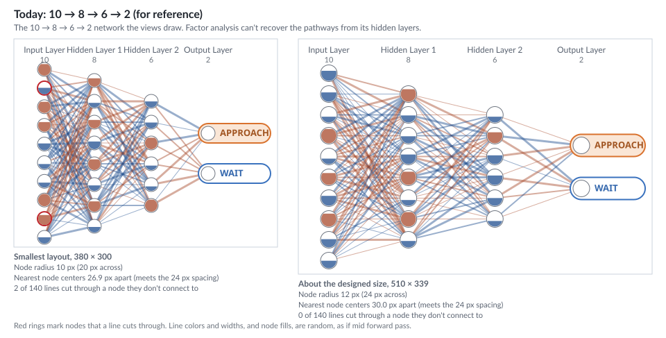
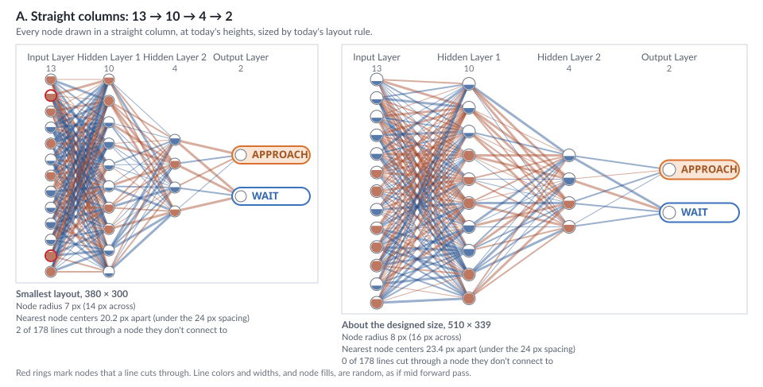
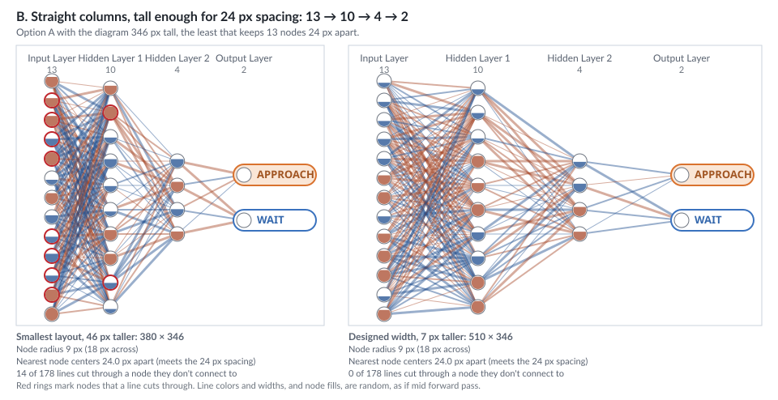
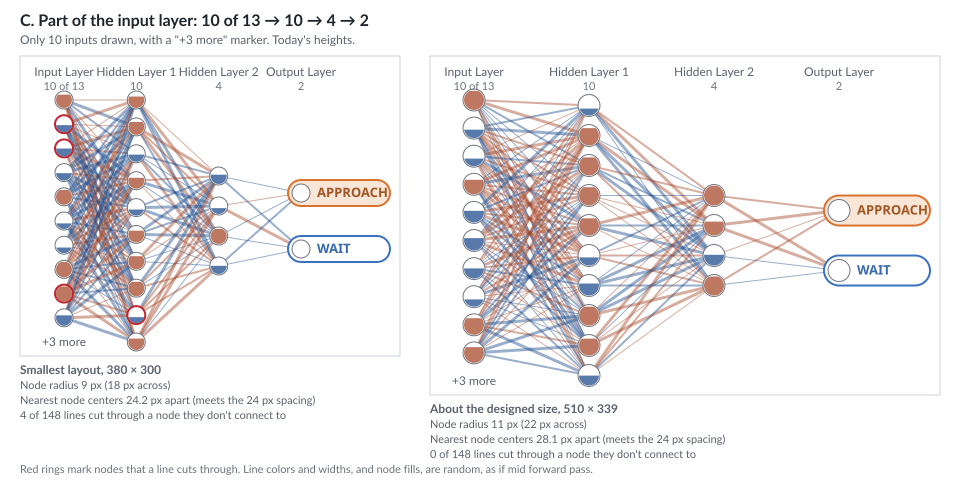
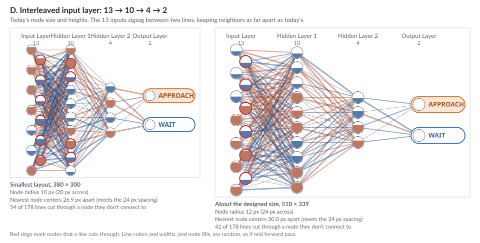
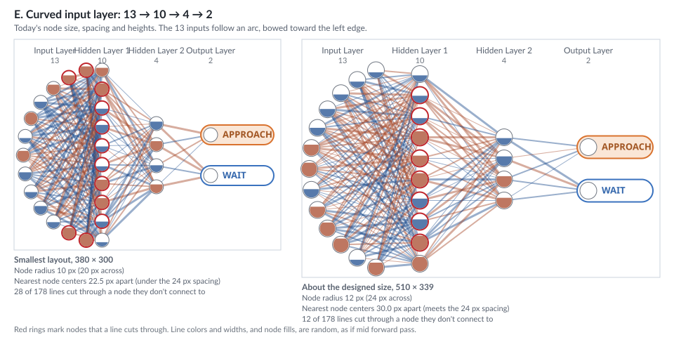

# Layout Options for the Generated Network

Trace a Case and Extract Pathways will draw a network generated from the alien3 data, so that its
hidden neurons show the same activations the pathways are extracted from. That network can't have
today's shape, 10 → 8 → 6 → 2. These pictures show ways to draw the shape it needs instead.

## Why the shape changes

Factor analysis finds the pathways from how the neurons it is given rise and fall together, and it
needs each of those neurons to have some variation of its own. Two things follow:

- **All the pathway neurons have to be in one hidden layer.** A neuron in a second hidden layer is
  computed from the first, so its variation is copied rather than its own. Factor analysis takes the
  copying as a shared cause and blends the pathways. A second hidden layer can still exist, but
  Extract Pathways can't lift neurons from it.
- **That layer needs enough inputs.** For the network to produce authored pathway scores, each
  pathway neuron carries the 3 pathways plus quirks of its own, independent of the pathways and of
  each other. That takes 3 + n independent inputs for n pathway neurons. (A network that only had to
  match how the neurons vary together could get by with n, but then nothing in it would be a
  pathway score.)

[../../factor-analysis-dependent-neurons.md](../../factor-analysis-dependent-neurons.md) explains
both.

The smallest workable pathway layer is about 10 neurons. Below that, factor analysis can't reliably
recover the weakest pathway, the one tied to resource stress. Even at 10 it is borderline, so 11
would give more margin. These pictures use the smallest workable network:

- **13 inputs** (3 + 10);
- **Hidden Layer 1: 10 pathway neurons**, the neurons Extract Pathways lifts;
- **Hidden Layer 2: 4 neurons**, a small decision layer that combines the pathways into the
  prediction;
- **2 outputs**, Approach and Wait.

## What to look for

Each picture shows one layout at two sizes:

- **The smallest layout**, 380 × 300, the smallest the diagram gets in Trace a Case.
- **About the designed size**, 510 × 339, which is what Trace a Case gives the diagram at its
  designed size of 1024 × 562.

Every line is colored and given a width as if mid forward pass, the busiest case. The colors, the
widths and the node fills are random, not real network values.

Under each size, three numbers:

- **Node radius.** Bigger nodes make the activation fill easier to see. Today's nodes are 10–12 px in
  radius.
- **Nearest node centers.** Nodes will be click and touch targets. WCAG 2.5.8 accepts targets
  smaller than 24 px if their centers are at least 24 px apart, so this needs to be 24 or more.
- **Lines cutting through a node they don't connect to.** A line drawn under a node looks like it
  connects to it. Red rings mark the nodes this happens to.

`npm run draw:network-layout-options` redraws the pictures and prints the numbers below. Its script,
[scripts/docs/draw-network-layout-options.ts](../../../scripts/docs/draw-network-layout-options.ts),
places straight columns with the diagram's own layout code, and holds the list of options to edit
for other counts or shapes.

## Summary

| Option | Node radius, smallest / designed | Nearest centers, smallest / designed | Lines cutting through a node, smallest / designed |
|---|---|---|---|
| Today, 10 → 8 → 6 → 2 | 10 / 12 px | 26.9 / 30.0 px | 2 / 0 of 140 |
| A. Straight columns | 7 / 8 px | **20.2 / 23.4 px** ✗ | 2 / 0 of 178 |
| B. Straight columns, 346 px tall | 9 / 9 px | 24.0 / 24.0 px | 14 / 0 of 178 |
| C. Part of the input layer | 9 / 11 px | 24.2 / 28.1 px | 4 / 0 of 148 |
| D. Interleaved input layer | 10 / 12 px | 26.9 / 30.0 px | **54 / 42** of 178 |
| E. Curved input layer | 10 / 12 px | **22.5** ✗ / 30.0 px | **28 / 12** of 178 |

The 10 pathway neurons fit in every option: they are as many as today's input layer, so Hidden Layer
1 keeps today's node size. The 13 inputs are the hard part.

## Today, for reference

The 10 → 8 → 6 → 2 network the views draw now, fitted to the alien3 data. Factor analysis still can't
recover the pathways from its hidden layers.

## A. Straight columns

Every node drawn, in straight columns, at today's heights. The 13 inputs set the node size, which
comes out smaller than today's, and the nodes are too close together for the 24 px spacing at both
sizes.

## B. Straight columns, a little taller

Option A with the diagram 346 px tall, the least that keeps 13 nodes 24 px apart. That raises Trace
a Case's minimum layout height from 523 to 569 px, 7 px more than the 562 px designed height,
unless 7 px can be saved elsewhere in the view. The nodes are 18 px across. At the smallest width,
some steep lines cut through neighboring nodes.

## C. Part of the input layer

Only 10 of the 13 inputs drawn, with a "+3 more" marker, at today's heights. It meets the 24 px
spacing at both sizes, and no lines cut through nodes at the designed size. Each hidden neuron's
value also depends on the 3 inputs students can't see. The inputs are a black box in the activity
anyway, but the edges students see no longer add up to everything that drives a neuron.

## D. Interleaved input layer

The 13 inputs zigzag between two lines, so they keep today's node size and spacing at today's
heights. But every line from the back row passes through the front row, so dozens of lines appear to
connect to nodes they don't. Lines curving around the nodes could fix that, but there are 130 lines
in this gap alone, and curves would be harder to follow.

## E. Curved input layer

The 13 inputs follow an arc, bowed toward the left edge, keeping today's node size at today's
heights. Fewer lines cut through nodes than in D, but some still do. At the smallest layout, the arc
has to bow so far that its ends swing toward Hidden Layer 1. They come within 22.5 px of its first
and last nodes, under the 24 px spacing.
